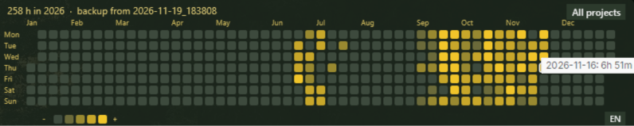

# HitMap-on-Desktop-for-SuperProductivity-
A Rainmeter skin that shows your Super Productivity activity as a GitHub-style yearly heatmap on your Windows desktop. Filter by project, use project colors, hover any day for its tracked time, and switch between English and French.


# SPHeatmap

**A heatmap of your Super Productivity activity, right on your Windows desktop.**

SPHeatmap is a [Rainmeter](https://www.rainmeter.net/) skin that shows the time you track each day in [Super Productivity](https://super-productivity.com/) as a yearly calendar, GitHub-contributions style. Drop it anywhere on your desktop, pick a project (or all of them), and you're done.

> 🪟 **Windows only.** SPHeatmap relies on Rainmeter, which only runs on Windows. It does not work on macOS or Linux.



---

## ✨ Features

- 📅 **Yearly view** from January to December, Monday to Sunday
- 🎨 **Project colors**: the map uses the primary color of the selected Super Productivity project (yellow by default for "All projects")
- 🗂️ **Project filter**: one click to switch projects, your choice is remembered
- 🌍 **Two languages, English or French**: switch anytime with the **FR / EN** button in the bottom-right corner; months, weekdays and labels are translated, and your choice is remembered
- 💬 **Tooltips**: hover over any day to see its date and the exact time tracked
- ⬜ **Today** highlighted with a white outline
- 🔄 **Automatic refresh** on launch and every 24 hours (or on demand)
- 🪶 **Lightweight**: no dependencies, no Python, no background service
- 🔒 **100% local**: only reads the automatic backups stored on your PC, nothing is sent anywhere

## 📋 Requirements

- **Windows 10 or 11** (Windows only, no macOS or Linux support)
- [Rainmeter](https://www.rainmeter.net/) 4.5 or later
- [Super Productivity](https://super-productivity.com/) (standard or Microsoft Store version) with **automatic backups enabled**

## 🚀 Installation

1. Install Rainmeter if you haven't already.
2. Download the latest `SPHeatmap_x.x.rmskin` file from the [Releases](../../releases) page.
3. Double-click it, then click **Install**.
4. The widget appears: drag it wherever you like on your desktop.

## ⚙️ Configuration

### Backup folder

SPHeatmap reads the most recent Super Productivity automatic backup. Its location depends on your version:

| Version | Folder |
|---|---|
| Standard (installer / portable) | `%APPDATA%\superProductivity\backups\` |
| Microsoft Store | `%LOCALAPPDATA%\Packages\53707johannesjo.SuperProductivity_<id>\LocalCache\Roaming\superProductivity\backups\` |

> 💡 The exact path is shown in Super Productivity under **Settings → Automatic Backups**.

To change the folder: right-click the widget → **Edit skin**, then edit this variable:

```ini
[Variables]
BackupFolder=%APPDATA%\superProductivity\backups\
```

Save, then right-click → **Refresh skin**.

If the folder can't be found, the widget displays the path it's looking in, so you can fix it.

## 🖱️ Usage

| Action | Result |
|---|---|
| Drag the widget | Move it around the desktop |
| Left-click the project name | Next project |
| Right-click the project name | Previous project |
| Click **FR / EN** | Switch between English and French |
| Hover a day | Show its date and time tracked |
| Right-click elsewhere → **Actualiser la carte** | Reload the latest backup |

### Color legend

| Cell | Time tracked that day |
|---|---|
| Darkest | None |
| Level 2 | Less than 1 h |
| Level 3 | 1–2 h |
| Level 4 | 2–4 h |
| Brightest | 4 h or more |

## 🔧 How it works

1. Rainmeter's **FileView** plugin finds the newest `.json` file in the backup folder.
2. A **Lua** script parses it, collecting each task's time per day (`timeSpentOnDay`) and each project's color.
3. Subtasks are counted but their parent tasks are skipped, so the same time is never counted twice.
4. The grid is drawn with a single **Shape** meter.

## ⚠️ Known limitations

- **Not real-time**: the map is only as fresh as Super Productivity's automatic backups (usually every few hours).
- **Current year only** for now.
- Project names with non-Latin characters (emoji, etc.) may not display correctly.

## 🗺️ Roadmap

- [ ] Choose which year to display
- [ ] Customizable color thresholds
- [ ] Light / dark themes
